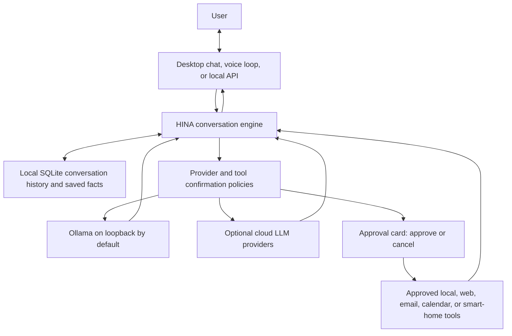

# HINA System Architecture

This document describes the current HINA-Core design. The showcase repository contains documentation; see [HINA-Core](https://github.com/BogguAjayKumar/HINA-Core) for the executable source and setup steps.

## Request flow



## Conversation interfaces

- The desktop chat is a PyQt6 application with text input, optional microphone input, spoken replies, session history, and study shortcuts.
- The voice assistant uses multilingual Faster-Whisper for local transcription and per-language MMS models for local speech generation. MMS TTS selects a GPU only when the installed PyTorch build supports its compute architecture, and retries on CPU if GPU inference fails. Optional Edge TTS is an external service.
- The conversation persona explicitly supports ordinary multilingual chat, study coaching, planning, and listening. Tools are optional action capabilities; their schemas do not limit the topics or languages HINA can discuss.
- The FastAPI interface listens on loopback by default and does not enable permissive cross-origin browser access.

## Reasoning and privacy modes

`HINA_LOCAL_ONLY=true` is the default. HINA routes reasoning only to Ollama and requires the configured Ollama URL to resolve to a loopback address. It does not use cloud fallback in this mode. A remote Ollama host is rejected by the same check.

Cloud providers are an explicit opt-in through `HINA_LOCAL_ONLY=false` and provider credentials. In that mode, prompts and any attached content sent to a provider are subject to that provider's handling. HINA's external lookups and connected-service tools also require user approval before execution.

## Memory and user control

- Conversation history and long-term facts are stored in local SQLite.
- HINA only prepares a long-term fact write after the user explicitly asks to remember it; the write then requires a separate approval.
- Users can review or remove saved facts and clear chat history and facts from the desktop chat.
- SQLite data is not encrypted by HINA. The clear-data action does not remove notes, reminders, lists, or other files maintained by integrations.

## Tool execution and approvals

Tool calls are routed through the shared registry. Tools that change local state, launch applications, access connected accounts, or send a query to an external service are configured to request confirmation. HINA returns a pending action with an approval identifier; the chat UI offers Approve and Cancel controls. A model-provided `confirmed` field does not authorize execution.

Approval should be reviewed against the displayed action details. Some integrations require credentials and access to local or external services; they are optional and must be configured by the user.

## Main code areas

```text
config/       Runtime settings and HINA's conversation persona
hina/audio/   Audio input, transcription, wake-word handling, and speech output
hina/brain/   Conversation engine, provider selection, and SQLite memory
hina/gui/     Desktop status overlay and chat companion
hina/tools/   Registered desktop, filesystem, web, and connected-service tools
hina/vision/  Screen and camera capture
run_hina_chat.bat   Desktop chat launcher for Windows
```
