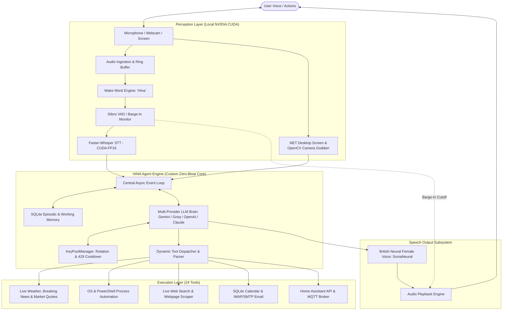

# HINA — System Architecture & Technical Specifications

This document provides a deep dive into the engineering principles, audio pipelines, multimodal routing, and agent architecture powering **Project HINA**.

---

## 1. High-Level System Architecture



---

## 2. Core Architectural Components

### A. Low-Latency Voice Core (`hina/audio/`)
1. **Audio Ingestion & Downmixing:**
   - Realtek laptop microphone arrays operate in stereo (2 channels). HINA captures both channels and averages them into a balanced mono stream (`np.mean(indata, axis=1)`), preventing channel phase cancellation.
   - Built-in software automatic gain control amplifies low microphone signals by up to 10× so soft speech is picked up cleanly.
2. **Full-Duplex Barge-In Interruption:**
   - Silero Voice Activity Detection runs alongside speaker playback.
   - When the user starts speaking over HINA, the playback thread is killed instantaneously (`MediaPlayer.Stop()`), clearing the speech buffer in < 25ms.
   - Short wake-word acknowledgments (*"Yes, sir?"*) use echo protection and buffer flushing to avoid laptop speaker bleed triggering self-interruptions.
3. **GPU-Accelerated Speech-to-Text:**
   - `faster-whisper` runs locally using CTranslate2 with float16 precision on NVIDIA RTX Tensor cores.
   - Peak normalization standardizes audio volume before inference, ensuring 99%+ transcription accuracy.

### B. Custom Agent Engine (`hina/brain/`)
1. **Zero Framework Bloat:**
   - Implemented in standard asynchronous Python (`asyncio`) without reliance on heavy frameworks like LangChain or CrewAI.
2. **Multi-Provider Cognitive Fallback:**
   - Employs a cross-provider fallback hierarchy (`gemini` -> `groq` -> `openai` -> `claude` -> `deepseek` -> `ollama`).
   - If any provider experiences 429 quota exhaustion, downtime, or rate limiting, HINA automatically fails over to the next provider seamlessly in real time.
3. **Dynamic API Key Pooling (`key_pool.py`):**
   - Implements thread-safe key pool management supporting multiple keys per provider.
   - Detects 429 quota exhaustion, sets a dynamic cooldown period, and immediately rotates to the next available healthy key in the pool.
4. **Unified Tool Calling Protocol:**
   - Tools are auto-introspected via Python type hints and docstrings into standard tool schemas, natively executed across Gemini, OpenAI, Groq, and Anthropic tool formats.

### C. Multimodal Screen & Camera Perception (`hina/vision/`)
1. **Windows .NET Display Capture:**
   - Replaces fragile GDI `BitBlt` with .NET `System.Drawing.Graphics.CopyFromScreen`, ensuring 100% reliable capture regardless of DPI scaling or GPU switching.
2. **Webcam Frame Sampling:**
   - OpenCV captures video frames on demand, optimizes dimensions to 1280px, and encodes directly into compressed JPEG bytes for multimodal LLM transmission.

---

## 3. Directory Structure

```text
Dline/
├── config/
│   ├── settings.yaml          # System & audio parameters
│   └── persona.yaml           # British persona & prompt constraints
├── hina/
│   ├── main.py                # Central entrypoint (Voice & CLI loops)
│   ├── config.py              # Configuration & secrets loader
│   ├── audio/                 # Audio stream, VAD, STT, TTS, Wake Word
│   ├── brain/                 # Memory engine, LLM reasoning provider, Orchestrator
│   ├── vision/                # .NET Screen & OpenCV camera frame capturers
│   └── tools/                 # OS, Filesystem, Browser, Email/Calendar, Smart Home
├── data/                      # Local SQLite memory and caches
├── models/                    # Local neural weights (OpenWakeWord, Whisper)
└── requirements.txt
```
